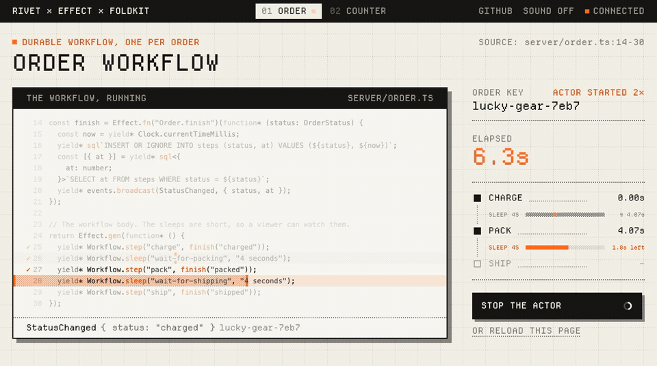
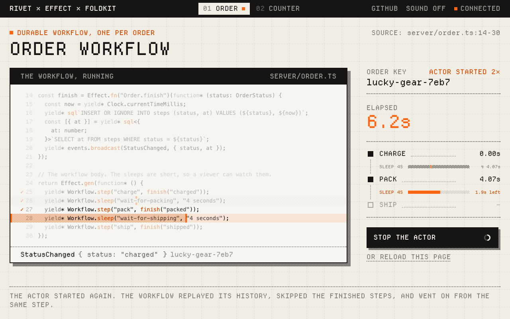

# foldkit-rivet



An [Effect UI](https://ui.effect.website) app over Rivet Actors written with `@rivetkit/effect`. One contract file is shared by the server and the browser, so every call is typed end to end.

Live: https://effectdemom78m.onrivet.dev

## What it shows

- **Durable workflow:** an `Order` runs `charge`, `pack` and `ship` steps with durable sleeps between them.
- **Stop and replay:** "Stop the actor" puts the order's actor to sleep mid-sleep. RivetKit wakes it, and the workflow replays its history: done steps return their saved results, and nothing runs twice.
- **Proof it restarted:** the actor counts its wakes in SQLite and sends each new connection a `Connected` event, so the page shows "Actor started 2×".
- **Shared counter:** one `Counter` actor with a SQLite row and a live `CountChanged` event. "× 10 at once" shows 10 concurrent calls each getting a different count.
- **Typed client:** `getOrCreate`, typed actions, and `connect` with one `Stream` per event.



## Run

```sh
pnpm install
pnpm build
pnpm start:local   # http://localhost:8080
```

Devtools: the overlay shows on `localhost` or with `?devtools`. For agents, run `pnpm dev:web` (port 8180, next to the running server) and point the agent at the MCP server on `http://127.0.0.1:4780/mcp`.

## Deploy

```sh
printf %s "$ADMIN_TOKEN" | rivet cluster secret rollout RIVET_ADMIN_TOKEN --yes --cluster <cluster> --org <org>
rivet deploy --cluster <cluster> --org <org> --yes \
  --env PUBLIC_RIVET_ENDPOINT=https://<cluster-api-host> \
  --env PUBLIC_RIVET_NAMESPACE=default \
  --secret RIVET_ADMIN_TOKEN
```

`/token` gives each visitor a 15-minute token for the namespace. That is fine for a demo; a real app checks the user first.

## Layout

```
shared/api.ts   contracts: Counter actor and Order workflow
server/         counter, order workflow, HTTP (/config.json, /token, /health, /metrics)
web/src/        Effect UI app: model, update, commands, subscriptions, views
```

`rivetkit-effect-pr1800.tgz` is a prerelease of `@rivetkit/effect`.

`@effect/ui` is a public preview that is not on npm yet. `package.json` installs a [pkg.pr.new](https://pkg.pr.new/~/Effect-TS/ui) snapshot pinned to commit `87a704b` of [Effect-TS/ui](https://github.com/Effect-TS/ui), so `pnpm install` needs network access.
