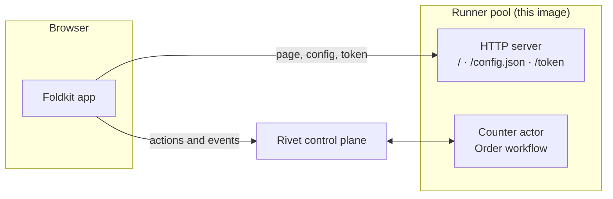

# foldkit-rivet

A [Foldkit](https://foldkit.dev) frontend that talks to [Rivet Actors](https://rivet.dev) written with the Rivet Effect SDK. One contract file is shared by the server and the browser, so every call is typed end to end.

Live demo: https://effectdemom78m.onrivet.dev

| Piece | What it shows |
| --- | --- |
| `Order` workflow | A durable workflow: `charge`, `pack` and `ship` steps with durable sleeps between them. It keeps its progress across crashes and reloads. |
| `Counter` actor | An actor with SQLite and a live `CountChanged` event. |
| Foldkit app | Starts orders, shows each step as it happens, and keeps two open tabs in sync. |
| Effect client | `getOrCreate`, typed actions, `connect` with one `Stream` for each event, and `getToken`. |

> [!NOTE]
> `rivetkit-effect-3.1.0-rc.tgz` is a prerelease of `@rivetkit/effect`, packed from the unreleased Effect SDK update. It needs `rivetkit` 3.0.7 or later and `effect` 4.1.x.

## How it works



1. The browser loads the app and `/config.json` from the pool's public URL.
2. It gets a short-lived token from `/token`. The server issues it with the cluster's admin token, which never leaves the server.
3. The Effect client calls the actors through the Rivet control plane, and `connect` streams their events back.

## Project layout

```
shared/api.ts        Contracts: Counter (Actor.make) and Order (Workflow.make)
server/counter.ts    Counter implementation
server/order.ts      Order workflow implementation
server/http.ts       Static files, /config.json, /token, /healthz
server/main.ts       Starts the actors and the HTTP server
web/src/main.ts      Foldkit app: model, messages, commands, subscriptions, view
web/src/entry.ts     Foldkit entry point
Dockerfile           Runner image for Rivet Cloud
```

## The workflow

```ts
export const OrderLive = Order.toLayer(
	Effect.gen(function* () {
		const sql = yield* Order.sql;
		const events = yield* Order.events;

		const finish = Effect.fn("Order.finish")(function* (status: OrderStatus) {
			const now = yield* Clock.currentTimeMillis;
			yield* sql`INSERT OR IGNORE INTO steps (status, at) VALUES (${status}, ${now})`;
			const [{ at }] = yield* sql<{ at: number }>`SELECT at FROM steps WHERE status = ${status}`;
			yield* events.broadcast(StatusChanged, { status, at });
		});

		return Effect.gen(function* () {
			yield* Workflow.step("charge", finish("charged"));
			yield* Workflow.sleep("wait-for-packing", "4 seconds");
			yield* Workflow.step("pack", finish("packed"));
			yield* Workflow.sleep("wait-for-shipping", "4 seconds");
			yield* Workflow.step("ship", finish("shipped"));
		});
	}),
	{
		db: db({ onMigrate: createStepsTable }),
		actions: Effect.gen(function* () {
			const sql = yield* Order.sql;
			return Order.of({ GetStatus: () => readSteps(sql) });
		}),
	},
);
```

Shortened. See [`server/order.ts`](server/order.ts) for the full file.

## Run locally

Requirements: Node.js 22 or later and pnpm.

```sh
pnpm install
pnpm build
pnpm start:local
```

Open http://localhost:8080. `pnpm start:local` starts a local Rivet control plane on port 6420. No token is needed locally.

## Deploy to Rivet Cloud

Requirements: Docker and the [Rivet CLI](https://rivet.dev/docs/cli).

```sh
rivet login

# The server issues browser tokens with this. Pipe it, never pass it as an argument.
printf %s "$ADMIN_TOKEN" | rivet cluster secret rollout RIVET_ADMIN_TOKEN --yes \
  --cluster <cluster> --org <org>

rivet deploy --cluster <cluster> --org <org> --yes \
  --env PUBLIC_RIVET_ENDPOINT=https://<cluster-api-host> \
  --env PUBLIC_RIVET_NAMESPACE=default \
  --secret RIVET_ADMIN_TOKEN
```

The pool's public URL serves the app. Use the cluster's API host, not the pool's URL, for `PUBLIC_RIVET_ENDPOINT`.

## Environment variables

| Variable | Read by | Use |
| --- | --- | --- |
| `PUBLIC_RIVET_ENDPOINT` | `/config.json`, `/token` | Control plane URL for the browser. Default: `http://localhost:6420`. |
| `PUBLIC_RIVET_NAMESPACE` | `/config.json`, `/token` | Namespace. Default: `default`. |
| `RIVET_ADMIN_TOKEN` | `/token` | Secret, server only. Issues a 15-minute scoped token for the browser. When it is not set, `/token` answers `{"token": null}`. |
| `PORT` | HTTP server | Port for the app. Default: `8080`. Rivet Cloud sets it. |
| `RIVET_ENDPOINT`, `RIVET_TOKEN`, `RIVET_NAMESPACE`, `RIVET_POOL` | Actors | Rivet Cloud sets these. Do not set them yourself. |

## Security

`/token` gives every visitor a 15-minute token that can create and call actors in the namespace. That is fine for a demo. In a real app, check who the user is in `/token` and grant only what that user needs. See [scoped tokens](https://rivet.dev/docs/jwt).
